# The levels

The 11 levels are Nokia's, the same in every version from 1.01 to 1.24 except one tile: level 11's column 91, row 42 is brick up to 1.18 and a wet ramp (33) from 1.21. The remake has them in `js/rules.js` (`LEVELS`: a row of letters for each row of tiles, from `LEGEND`), made from the 1.24 JAR's files by `tools/levels-to-rules.mjs`, and turned back into those bytes by `tools/test-rules.mjs`.

## The files

`levels/J2MElvl.001` to `J2MElvl.011` in the JAR, one byte each, read unsigned, in this order:

| Bytes | What |
| --- | --- |
| 0, 1 | the ball's start tile (column, row) |
| 2 | the ball's size at the start: 0 small, anything else big (the files have 0 and 1) |
| 3, 4 | the exit's top-left tile (it's 2 × 2) |
| 5 | how many hoops there are |
| 6, 7 | the width and the height, in tiles |
| width × height | the tiles, a row at a time: the tile's id in bits 0–5, water in bit 6 (64). While the game runs, bit 7 (128) marks a tile to draw again |
| 1 | how many moving spikes there are |
| 8 each | the spike's area: left and top (tiles, included), right and bottom (tiles, not included); its speed across and down (px a step, read unsigned, so 255 is +255, not −1); where it starts, across and down (px from the area's top-left) |

A moving spike's 24 × 24 px box goes at most (right − left − 2) × 12 px across and (bottom − top − 2) × 12 px down. That can be less than 0 (level 9's fourth spike has an area one tile wide), and the spike then jumps back and forth. The 11 levels use 62 different tile bytes: 41 ids, 21 of them in water too.

## The tiles

Each tile is 12 × 12 px. What each one does in 1.24 (brick, rubber and the ramps are tested against the ball's round shape, 12 or 16 px across; the others against the box round it):

| Id | Tile | What it does |
| --- | --- | --- |
| 0 | sky (64: water) | nothing |
| 1 | brick | solid; any brick a test reaches sets the ball's touch flag (it slides and climbs) |
| 2 | rubber | solid; a hit sets the rubber flag (the next jump is higher) |
| 3–6 | spikes on the floor, the left wall, the ceiling, the right wall | a band through the middle, pixels 4–7 across the spikes, along the whole tile: pops the ball, and blocks |
| 7 | crystal | passed through; +200, and the ball comes back here (at its size then); the last crystal touched (or the start) empties, and this one becomes 8 |
| 8 | a crystal taken (an arrow) | nothing |
| 9 | the exit | a band through each tile's middle (pixels 4–7 across): blocks until the door is open; through it, the level is done (`game.md`) |
| 10 | where moving spikes go | the spike's 24 × 24 box, less 1 px all round, against the ball's box, less 1 px: pops the ball. Where two spikes' areas overlap, the first spike counts |
| 13, 14 | small hoop standing: top, bottom half | the band through the middle (pixels 4–7) passes it: +500, the "up" tune, both halves become passed (+4, keeping the touched half's water). Posts at the ends of the band (the rims) block, on top halves of standing hoops and both halves of lying ones. Small hoops are too small for the big ball: their band blocks it |
| 15, 16 | small hoop lying: left, right half | the same |
| 21–24 | big hoops, the same four | the same, for either ball; on 23, a rim blocks without passing the hoop |
| 17–20, 25–28 | the hoops passed | their rims still block, and small ones still block the big ball |
| 29 | crystal ball | passed through; +1000, a spare ball (up to 5), and the tile empties |
| 30–33 | brick ramps, solid in the top-left, top-right, bottom-right, bottom-left half | a triangle; hit in the air, it turns the ball (`ball-1.24.md`) |
| 34–37 | rubber ramps, the same | the same, and the rubber flag |
| 38 | speed | solid; each step it's touched: 300 steps of a top speed of 100 (not 50) |
| 39–42 | deflater on the floor, the left wall, the ceiling, the right wall | solid; a big ball touching it becomes small, where it is |
| 43–46 | pump, the same | a 4 px post (the band) that blocks; a small ball touching it becomes big and moves to the nearest free spot |
| 47–50 | gravity, the same | solid; 300 steps of gravity upside down |
| 51–54 | jump, the same | solid; 300 steps of a higher jump (−147 instead of −67) |

Outside the map is solid, and while the ball pops every tile is. A test applies the effect of every tile it reaches until one blocks, whether or not the ball then moves there.

## Each level

The pictures are each level at its start, drawn with the game's own `js/sprites.js` (Nokia's sprites): the ball at its start, the moving spikes where they start, the exit shut. A tile is 12 × 12 px. The phone's screen shows 128 × 96 px of it at a time, and never a level's last 16 px on the right.

"Win" is the shortest winning route the search found (`tools/search-routes.mjs`; the routes are in `routes/routes.json`), in steps of 40 ms: what the replay test's bot plays.

| Level | Tiles | Ball | Hoops | Moving spikes | Crystals | Crystal balls | Water tiles | Pumps / deflaters | Power-ups (speed, gravity, jump) | Win |
| --- | --- | --- | --- | --- | --- | --- | --- | --- | --- | --- |
| 1 | 112 × 8 | small | 6 | 0 | 2 | 1 | 0 | 0 / 0 | 0, 0, 0 | 389 steps (16 s) |
| 2 | 134 × 22 | small | 8 | 6 | 3 | 2 | 0 | 1 / 9 | 0, 0, 0 | 974 steps (39 s) |
| 3 | 134 × 36 | big | 9 | 11 | 7 | 2 | 190 | 1 / 4 | 1, 0, 0 | 1433 steps (57 s) |
| 4 | 134 × 29 | small | 7 | 11 | 6 | 2 | 0 | 2 / 2 | 0, 0, 0 | 1241 steps (50 s) |
| 5 | 90 × 43 | big | 10 | 0 | 6 | 2 | 783 | 2 / 6 | 0, 1, 1 | 2277 steps (91 s) |
| 6 | 112 × 36 | small | 8 | 4 | 6 | 2 | 48 | 6 / 4 | 0, 0, 0 | 3218 steps (129 s) |
| 7 | 134 × 36 | small | 11 | 12 | 7 | 2 | 86 | 1 / 2 | 0, 0, 0 | 3929 steps (157 s) |
| 8 | 156 × 36 | small | 11 | 11 | 7 | 2 | 368 | 6 / 22 | 0, 1, 0 | 3726 steps (149 s) |
| 9 | 222 × 36 | small | 12 | 4 | 7 | 2 | 24 | 1 / 6 | 1, 0, 0 | 3084 steps (123 s) |
| 10 | 112 × 35 | small | 12 | 7 | 9 | 2 | 129 | 1 / 20 | 0, 1, 3 | 2082 steps (83 s) |
| 11 | 178 × 57 | big | 15 | 5 | 14 | 6 | 1010 | 3 / 12 | 0, 0, 2 | 5888 steps (236 s) |

### Level 1

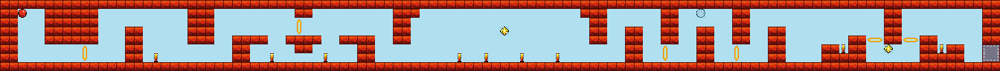

- **Size:** 112 × 8 tiles (1344 × 96 px).
- **The ball** starts small at tile 2, 1; **the exit** is at tile 110, 5 (2 × 2).
- **Hoops:** 6. **Crystals:** 2. **Crystal balls:** 1.
- **Tiles:** 400 brick, 0 rubber, 9 spikes, 0 brick and 0 rubber ramps, 0 in water.
- **Pumps:** 0. **Deflaters:** 0. **Power-ups:** 0 speed, 0 gravity, 0 jump.
- **Routes found:** exit-opening at step 684, win at step 389.

### Level 2

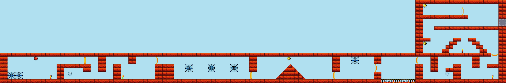

- **Size:** 134 × 22 tiles (1608 × 264 px).
- **The ball** starts small at tile 9, 15; **the exit** is at tile 132, 5 (2 × 2).
- **Hoops:** 8. **Crystals:** 3. **Crystal balls:** 2.
- **Tiles:** 528 brick, 0 rubber, 3 spikes, 8 brick and 0 rubber ramps, 0 in water.
- **Pumps:** 1. **Deflaters:** 9. **Power-ups:** 0 speed, 0 gravity, 0 jump.
- **Moving spikes** (area left, top, right, bottom in tiles; speed across, down in px a step; start offset in px):
  1. 49, 15, 51, 21; 0, 1; 0, 25
  2. 55, 15, 57, 21; 0, 1; 0, 24
  3. 61, 15, 63, 21; 0, 1; 0, 24
  4. 93, 15, 95, 21; 0, 1; 0, 0
  5. 2, 15, 4, 21; 0, 1; 0, 48
  6. 4, 15, 6, 21; 0, 1; 0, 48
- **Routes found:** pump at step 341, exit-opening at step 1545, deflater at step 2580, win at step 974.

### Level 3

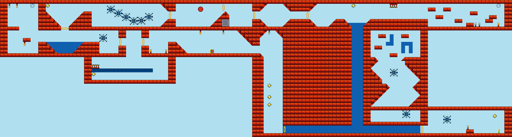

- **Size:** 134 × 36 tiles (1608 × 432 px).
- **The ball** starts big at tile 52, 2; **the exit** is at tile 58, 5 (2 × 2).
- **Hoops:** 9. **Crystals:** 7. **Crystal balls:** 2.
- **Tiles:** 1396 brick, 16 rubber, 12 spikes, 77 brick and 0 rubber ramps, 190 in water.
- **Pumps:** 1. **Deflaters:** 4. **Power-ups:** 1 speed, 0 gravity, 0 jump.
- **Moving spikes** (area left, top, right, bottom in tiles; speed across, down in px a step; start offset in px):
  1. 38, 1, 40, 7; 0, 1; 0, 29
  2. 36, 1, 38, 7; 0, 1; 0, 41
  3. 34, 1, 36, 7; 0, 1; 0, 42
  4. 32, 1, 34, 7; 0, 1; 0, 30
  5. 30, 1, 32, 7; 0, 1; 0, 18
  6. 28, 1, 30, 7; 0, 1; 0, 6
  7. 26, 8, 28, 14; 0, 1; 0, 12
  8. 116, 29, 118, 35; 0, 1; 0, 17
  9. 98, 29, 110, 31; 1, 0; 88, 0
  10. 100, 16, 106, 22; 1, 1; 25, 25
  11. 103, 23, 105, 29; 255, 1; 31, 31
- **Routes found:** deflater at step 556, speed at step 676, pump at step 953, exit-opening at step 1577, win at step 1433.

### Level 4

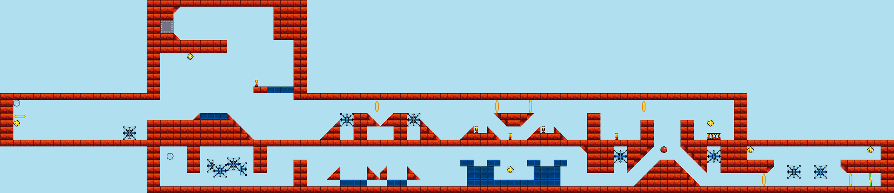

- **Size:** 134 × 29 tiles (1608 × 348 px).
- **The ball** starts small at tile 99, 22; **the exit** is at tile 24, 3 (2 × 2).
- **Hoops:** 7. **Crystals:** 6. **Crystal balls:** 2.
- **Tiles:** 711 brick, 53 rubber, 5 spikes, 55 brick and 0 rubber ramps, 0 in water.
- **Pumps:** 2. **Deflaters:** 2. **Power-ups:** 0 speed, 0 gravity, 0 jump.
- **Moving spikes** (area left, top, right, bottom in tiles; speed across, down in px a step; start offset in px):
  1. 92, 22, 94, 28; 0, 1; 0, 6
  2. 106, 22, 108, 28; 0, 1; 0, 6
  3. 122, 22, 124, 28; 0, 1; 0, 34
  4. 118, 22, 120, 28; 0, 1; 0, 34
  5. 34, 22, 36, 28; 0, 1; 0, 20
  6. 35, 22, 37, 28; 0, 1; 0, 29
  7. 32, 22, 34, 28; 0, 1; 0, 32
  8. 31, 22, 33, 28; 0, 1; 0, 23
  9. 61, 15, 63, 21; 0, 1; 0, 24
  10. 51, 15, 53, 21; 0, 1; 0, 24
  11. 5, 19, 21, 21; 1, 0; 161, 0
- **Routes found:** pump at step 311, deflater at step 606, exit-opening at step 1817, win at step 1241.

### Level 5

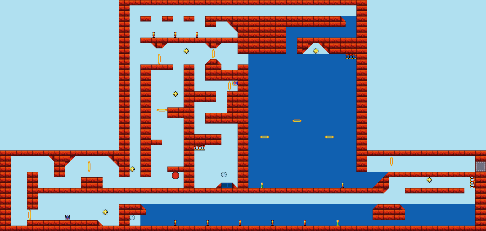

- **Size:** 90 × 43 tiles (1080 × 516 px).
- **The ball** starts big at tile 32, 32; **the exit** is at tile 88, 30 (2 × 2).
- **Hoops:** 10. **Crystals:** 6. **Crystal balls:** 2.
- **Tiles:** 869 brick, 2 rubber, 9 spikes, 28 brick and 0 rubber ramps, 783 in water.
- **Pumps:** 2. **Deflaters:** 6. **Power-ups:** 0 speed, 1 gravity, 1 jump.
- **Routes found:** jump at step 994, deflater at step 1065, pump at step 1218, gravity at step 1442, exit-opening at step 2874, win at step 2277.

### Level 6

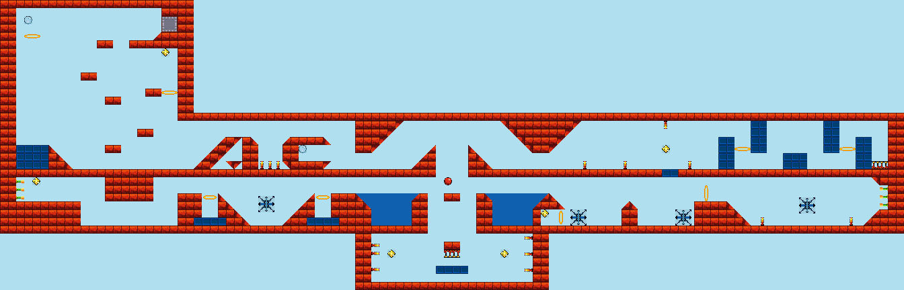

- **Size:** 112 × 36 tiles (1344 × 432 px).
- **The ball** starts small at tile 55, 22; **the exit** is at tile 20, 2 (2 × 2).
- **Hoops:** 8. **Crystals:** 6. **Crystal balls:** 2.
- **Tiles:** 688 brick, 64 rubber, 15 spikes, 61 brick and 0 rubber ramps, 48 in water.
- **Pumps:** 6. **Deflaters:** 4. **Power-ups:** 0 speed, 0 gravity, 0 jump.
- **Moving spikes** (area left, top, right, bottom in tiles; speed across, down in px a step; start offset in px):
  1. 70, 26, 77, 28; 1, 0; 8, 0
  2. 79, 26, 86, 28; 1, 0; 56, 0
  3. 99, 22, 101, 28; 0, 1; 0, 30
  4. 32, 22, 34, 28; 0, 1; 0, 28
- **Routes found:** pump at step 358, deflater at step 883, exit-opening at step 3764, win at step 3218.

### Level 7

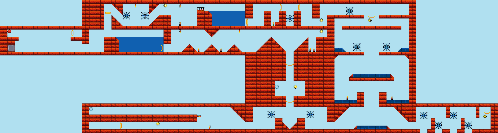

- **Size:** 134 × 36 tiles (1608 × 432 px).
- **The ball** starts small at tile 2, 8; **the exit** is at tile 2, 12 (2 × 2).
- **Hoops:** 11. **Crystals:** 7. **Crystal balls:** 2.
- **Tiles:** 1234 brick, 34 rubber, 13 spikes, 64 brick and 2 rubber ramps, 86 in water.
- **Pumps:** 1. **Deflaters:** 2. **Power-ups:** 0 speed, 0 gravity, 0 jump.
- **Moving spikes** (area left, top, right, bottom in tiles; speed across, down in px a step; start offset in px):
  1. 33, 1, 35, 7; 0, 1; 0, 27
  2. 38, 1, 40, 7; 0, 1; 0, 27
  3. 68, 30, 74, 32; 1, 0; 48, 0
  4. 82, 30, 88, 32; 1, 0; 6, 0
  5. 113, 29, 115, 36; 0, 1; 0, 15
  6. 117, 29, 119, 36; 0, 1; 0, 47
  7. 121, 29, 123, 36; 0, 1; 0, 15
  8. 125, 29, 127, 36; 0, 1; 0, 47
  9. 103, 8, 105, 14; 0, 1; 0, 45
  10. 95, 8, 97, 14; 0, 1; 0, 45
  11. 90, 2, 110, 4; 1, 0; 37, 0
  12. 77, 1, 79, 7; 0, 1; 0, 36
- **Routes found:** pump at step 2239, deflater at step 2346, exit-opening at step 4295, win at step 3929.

### Level 8

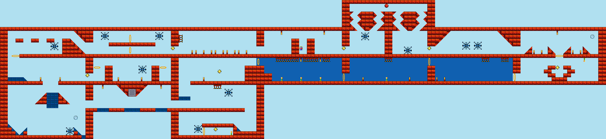

- **Size:** 156 × 36 tiles (1872 × 432 px).
- **The ball** starts small at tile 99, 1; **the exit** is at tile 33, 23 (2 × 2).
- **Hoops:** 11. **Crystals:** 7. **Crystal balls:** 2.
- **Tiles:** 1001 brick, 30 rubber, 30 spikes, 76 brick and 9 rubber ramps, 368 in water.
- **Pumps:** 6. **Deflaters:** 22. **Power-ups:** 0 speed, 1 gravity, 0 jump.
- **Moving spikes** (area left, top, right, bottom in tiles; speed across, down in px a step; start offset in px):
  1. 93, 8, 95, 14; 0, 1; 0, 5
  2. 104, 8, 106, 14; 0, 1; 0, 49
  3. 26, 8, 28, 14; 0, 1; 0, 4
  4. 40, 8, 42, 14; 0, 1; 0, 4
  5. 4, 11, 15, 13; 1, 0; 108, 0
  6. 122, 8, 124, 14; 0, 1; 0, 34
  7. 119, 8, 121, 14; 0, 1; 0, 34
  8. 29, 17, 39, 19; 1, 0; 80, 0
  9. 7, 33, 19, 35; 1, 0; 120, 0
  10. 49, 23, 66, 25; 1, 0; 106, 0
  11. 50, 29, 52, 35; 0, 1; 0, 41
- **Routes found:** gravity at step 375, pump at step 389, deflater at step 538, exit-opening at step 4076, win at step 3726.

### Level 9

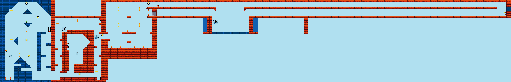

- **Size:** 222 × 36 tiles (2664 × 432 px).
- **The ball** starts small at tile 43, 8; **the exit** is at tile 66, 5 (2 × 2).
- **Hoops:** 12. **Crystals:** 7. **Crystal balls:** 2.
- **Tiles:** 1029 brick, 261 rubber, 13 spikes, 9 brick and 31 rubber ramps, 24 in water.
- **Pumps:** 1. **Deflaters:** 6. **Power-ups:** 1 speed, 0 gravity, 0 jump.
- **Moving spikes** (area left, top, right, bottom in tiles; speed across, down in px a step; start offset in px):
  1. 26, 11, 30, 15; 1, 1; 9, 9
  2. 41, 10, 43, 18; 0, 1; 0, 64
  3. 92, 8, 96, 12; 1, 1; 9, 9
  4. 105, 8, 106, 13; 255, 1; 12, 12
- **Routes found:** pump at step 917, deflater at step 946, speed at step 1554, exit-opening at step 3063, win at step 3084.

### Level 10

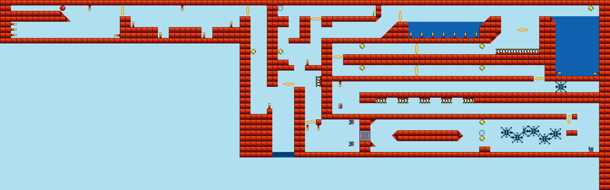

- **Size:** 112 × 35 tiles (1344 × 420 px).
- **The ball** starts small at tile 11, 1; **the exit** is at tile 66, 24 (2 × 2).
- **Hoops:** 12. **Crystals:** 9. **Crystal balls:** 2.
- **Tiles:** 906 brick, 4 rubber, 24 spikes, 17 brick and 0 rubber ramps, 129 in water.
- **Pumps:** 1. **Deflaters:** 20. **Power-ups:** 0 speed, 1 gravity, 3 jump.
- **Moving spikes** (area left, top, right, bottom in tiles; speed across, down in px a step; start offset in px):
  1. 99, 22, 101, 28; 0, 1; 0, 31
  2. 94, 22, 96, 28; 0, 1; 0, 28
  3. 97, 23, 99, 28; 0, 1; 0, 2
  4. 95, 23, 97, 28; 0, 1; 0, 2
  5. 101, 23, 103, 28; 0, 1; 0, 8
  6. 92, 23, 94, 28; 0, 1; 0, 5
  7. 100, 15, 110, 17; 1, 0; 24, 0
- **Routes found:** jump at step 559, pump at step 975, deflater at step 1112, gravity at step 1861, exit-opening at step 2487, win at step 2082.

### Level 11

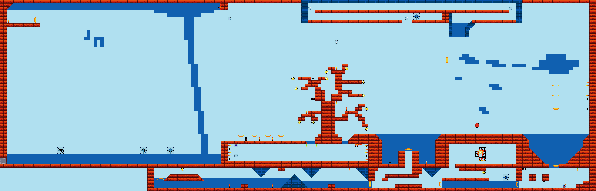

- **Size:** 178 × 57 tiles (2136 × 684 px).
- **The ball** starts big at tile 142, 37; **the exit** is at tile 0, 47 (2 × 2).
- **Hoops:** 15. **Crystals:** 14. **Crystal balls:** 6.
- **Tiles:** 1326 brick, 137 rubber, 33 spikes, 27 brick and 34 rubber ramps, 1010 in water.
- **Pumps:** 3. **Deflaters:** 12. **Power-ups:** 0 speed, 0 gravity, 2 jump.
- **Moving spikes** (area left, top, right, bottom in tiles; speed across, down in px a step; start offset in px):
  1. 46, 44, 60, 46; 1, 0; 47, 0
  2. 24, 44, 46, 46; 1, 0; 215, 0
  3. 2, 44, 24, 46; 1, 0; 182, 0
  4. 146, 52, 154, 54; 1, 0; 49, 0
  5. 122, 4, 129, 6; 1, 0; 17, 0
- **Routes found:** deflater at step 236, pump at step 670, jump at step 606, exit-opening at step 5869, win at step 5888.

