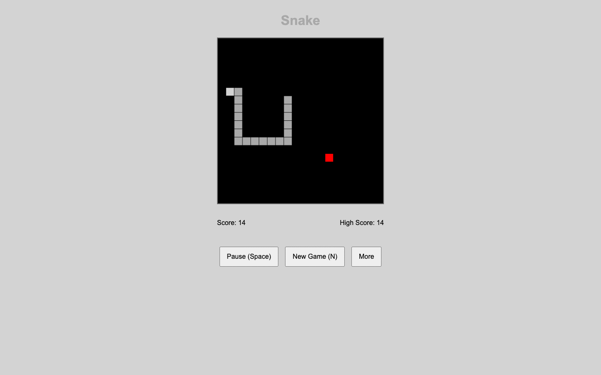

# Flappy Bird

Flap through the gaps between the pipes, as far as you can: the classic one-button game, in the original's style. Every picture is drawn in code (no image files from the original), and the sounds are made in the browser.



**[Play in GameHub](https://gamehub.foo/g/flappy-bird)** · [Play directly](https://flappy-bird.dt-games.pages.dev) · [Source code](https://github.com/DanyilT/dt-games/tree/flappy-bird)

## 🕹️ Controls

Flap to start. In GameHub, click the game first, so it has the keyboard: it says so.

| Keys | Action |
| --- | --- |
| <kbd>Space</kbd> / <kbd>↑</kbd> / <kbd>W</kbd> | Flap (and start, carry on after a pause, or leave the scoreboard) |
| Click | Flap (or, on the button at the top left, pause) |
| <kbd>P</kbd> / <kbd>Esc</kbd> | Pause or resume |
| <kbd>R</kbd> | Back to Get Ready |
| <kbd>M</kbd> | Sound on or off |
| <kbd>I</kbd> | Show or hide the instructions |

On a phone or tablet:

- **Tap** anywhere on the game to flap.
- **Tap** the button at the top left of the game to pause, and tap again to carry on.

## ✨ Features

- The original's look: the bird, the green pipes, the city and the bushes, the striped ground, the blocky score
- Get Ready, then a scoreboard with your score, your best and a medal: bronze from 10, silver from 20, gold from 30, platinum from 40
- Smooth on any screen: the game moves in fixed steps, and the picture is drawn in between
- Sounds made in the browser (Web Audio), on or off with M
- Pauses by itself when you switch away (another tab, a locked phone, a click outside GameHub's frame), and carries on where you left off next time
- Mobile-friendly: a tap is a flap
- Easter Egg

## 💾 Saved data

The game saves one object: `{ "highScore": <int>, "medals": { "bronze": <int>, "silver": <int>, "gold": <int>, "platinum": <int> }, "sound": <bool>, "game": { … } | null }`: your best score, the medals you've won, whether the sound is on, and the game you're playing.
`game` is kept when the game pauses, or when you switch away or close the page, so it comes back next time, paused: the bird, the pipes and the score (`state`), the run so far for GameHub (`run`, see below), and your best before it. It's taken out when the game ends, or when you go back to Get Ready.
It's kept in the browser, in `localStorage` under `flappy-birdGameData`, and in your GameHub account when you play in GameHub signed in (see below).
If the browser blocks storage (some do inside an iframe), the game still plays, but it doesn't remember your best score.

## 👾 GameHub

[GameHub](https://gamehub.foo) plays this game in a frame. `js/gamehub.js` connects the two: it's the same file in every game, loaded before the game's own scripts.

- **Saves:** the game saves only through `window.GameHub`. Every save stays in this browser, as before. When you play in GameHub signed in, your progress also goes to your GameHub account, and the game loads the account's copy, so it follows you from device to device. The first time you play signed in on a device, if your account has no save for this game yet, this device's goes up.
- **The play area:** GameHub asks the game to put its play area in the middle of the frame (the `gamehub:center` message).
- **The frame view:** in GameHub's frame, the game shows only what's needed to play: the canvas alone, as big as the frame allows (a click or a tap flaps, and its pause button is on it). In full screen it shows the whole page. `js/gamehub.js` sets `data-gamehub-view` on the page (`frame`, or `full` when GameHub's `gamehub:view` message says so), and `css/page.css` says what the frame shows.
- **Pausing and loading:** the game pauses when GameHub asks (the `gamehub:pause` message) and when its frame loses the keyboard, and it tells GameHub when it's ready to play (`GameHub.playable()`, the `gamehub:playable` message).
- **Offline:** you can download the game in GameHub (the Download button on its page there) to play it offline.
- **The panel and replays:** under the game, GameHub shows what the game tells it with `GameHub.status()` (the score now, your best, and your medals behind its More button), and each game you finish is kept as a run, so you can watch it again there: the run's random seed and your flaps, never a video. The game moves in fixed 16 ms steps, the pipes' gaps come from the run's seed, and each flap is recorded with the step it came after. Runs stay in your browser. A cheat (the console, the Easter egg) means that game isn't kept.
- **Checked runs:** signed in, GameHub hands the game a few tickets, each a seed its server chose, and each run takes one. GameHub then plays the run again on its server with this game's own rules (`js/rules.js`, the code the game plays by, in whole numbers so every browser and the server work it out the same), so only results it got itself count as your records (it does this offline too, once you're back online). A game's run starts with its first flap, so Get Ready takes no ticket; the first one waits for the tickets (`GameHub.ready()`) if you're quicker. It's saved with the game in progress, so it carries on after a reload.
- **Only GameHub:** it loads GameHub's script (`/hub-bridge.js`) only when the game is in a frame on GameHub's own address.

The game works without it: played on its own, or when GameHub can't be reached (the game gives it 3 seconds at most), everything stays in this browser.

## 👀️ Links

- **Play in GameHub:** https://gamehub.foo/g/flappy-bird
- **Play directly:** https://flappy-bird.dt-games.pages.dev
- **Source code:** https://github.com/DanyilT/dt-games/tree/flappy-bird
- **The other games:** [Snake](https://github.com/DanyilT/dt-games/tree/snake), [Tetris](https://github.com/DanyilT/dt-games/tree/tetris), [Minesweeper](https://github.com/DanyilT/dt-games/tree/minesweeper), [Sudoku](https://github.com/DanyilT/dt-games/tree/sudoku) and [Tic-Tac-Toe](https://github.com/DanyilT/dt-games/tree/tic-tac-toe), each on its own branch of [DanyilT/dt-games](https://github.com/DanyilT/dt-games)
- **GameHub**, the site with all my games: https://github.com/DanyilT/game-hub
- **The original:** Flappy Bird by Dong Nguyen (.GEARS, 2013). This is a fan remake, with its own drawings and sounds.

## 🔌 Run it locally

It's plain HTML, CSS and JavaScript: no build step, nothing to install. Serve the folder with any static server, for example:

```bash
python3 -m http.server
```

Then open http://localhost:8000.

## 🔬 Test it

`test/index.html` is a replay test: a bot plays Flappy Bird through the page's own controls, and each run it finishes is played again with `js/rules.js` (what GameHub's server checks runs with), which must come out as the game said. Serve the folder as above and open http://localhost:8000/test/ (or http://localhost:8000/test/?start to start at once). The game there saves under a name of its own, so your best score stays as it was. *Copy the runs as JSON* gives the runs in the shape of GameHub's test fixtures.

## 💿 Get just this game

Every game lives on its own branch of [DanyilT/dt-games](https://github.com/DanyilT/dt-games). To clone only this one:

```bash
git clone --branch flappy-bird --single-branch https://github.com/DanyilT/dt-games.git flappy-bird
```

## 🧻 License

This game is licensed under the [MIT License](LICENSE).
